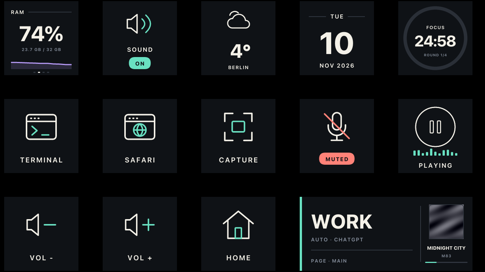

# D200 Deck

Custom software for the **Ulanzi D200 / D200H** stream controller, in two parts:

- **`d200fw`** is a small replacement for the stock `UlanziDeckKey` app on the device. It takes
  over the screen and the 14 keys and speaks a simple line protocol over USB (adb). The stock
  Linux, kernel and bootloader stay as they are, and you can always go back to the stock UI.
- **D200 Deck** is a desktop app (Tauri: Rust plus plain HTML/JS). It draws every key, runs the
  actions and edits the config. Features:
  - profiles that follow the active app
  - four key events (down, up, press, long press)
  - key states
  - built-in live widgets
  - notification cards on the wide key
  - a seasonal screensaver
  - Home Assistant over MQTT



## Repository layout

| Path | What it is |
|---|---|
| `device/` | `d200fw`, Rust with no dependencies, cross-built as a static ARMv7 binary |
| `bin/d200fw` | Prebuilt device binary. The app embeds it and installs it over adb |
| `scripts/` | Shell scripts for the device: `try.sh`, `test-keys.sh`, `install.sh`, `uninstall.sh`, `wrapper.sh` |
| `app/` | D200 Deck: `src-tauri/` (Rust engine) and `ui/` (plain HTML/JS, no bundler) |
| `app/ui/icons/night-signal/` | Night Signal icon set: 218 SVGs, manifest, stateful icons |
| `tests/e2e/` | End-to-end tests against a simulated device, MQTT broker, Teams and IDE |
| `host/` | The first Python prototype (v1 config format). Kept for reference only |
| `docs/` | Documentation, see below |

## Quick start (macOS)

```sh
brew install android-platform-tools                 # adb
rustup target add armv7-unknown-linux-musleabihf    # only to rebuild device/
cd app && npm install && npx tauri dev
```

Plug the D200 in over USB. The app finds it over adb and pushes `d200fw` to `/tmp`, which
lasts until the next reboot. It draws your deck. To have it start at boot, see
[docs/firmware.md](docs/firmware.md).

## Install on macOS (without signing)

The app is not notarised by Apple. CI builds two files (the `d200-deck-macos` artifact of a
run, or a release):

- **`D200 Deck_<version>_universal.pkg`** (recommended): installs to `/Applications` and clears
  the quarantine flag, so macOS only asks once, for the installer. Double-click it; when macOS
  refuses, open **System Settings → Privacy & Security** and click **Open Anyway** next to the
  message (macOS 14 and older: right-click the .pkg → Open). Then follow the installer.
- **`D200 Deck_<version>_universal.dmg`**: drag the app to Applications. Before the first start,
  run once in Terminal:

  ```sh
  xattr -dr com.apple.quarantine "/Applications/D200 Deck.app"
  ```

Both run on Intel and Apple Silicon (macOS 11 or newer). The app is signed ad hoc, which Apple
Silicon needs to run it at all.

## Build and test

```sh
(cd device && cargo build --release && cp target/armv7-unknown-linux-musleabihf/release/d200fw ../bin/)
(cd app && npx tauri build)                          # -> app/src-tauri/target/release/bundle/
(cd app/src-tauri && cargo test --lib)               # unit tests
tests/e2e/run.sh                                     # end-to-end tests (Python 3, no device needed)
```

CI (`.github/workflows/ci.yml`) runs the unit and e2e tests on Linux, builds `d200fw` and a
universal macOS DMG on every push. A semver tag makes a GitHub release with both files; the
version comes from the tag (`scripts/set-version.sh`):

```sh
git tag v1.2.3 && git push origin v1.2.3            # v1.2.3-rc.1 makes a pre-release
```

## Documentation

| Doc | Contents |
|---|---|
| [docs/app.md](docs/app.md) | Using the app: design, keys, widgets, integrations, platform notes |
| [docs/config.md](docs/config.md) | `deck.json` reference |
| [docs/home-assistant.md](docs/home-assistant.md) | MQTT topics and Home Assistant examples |
| [docs/firmware.md](docs/firmware.md) | Try, install and uninstall on the device, safety and recovery |
| [docs/hardware.md](docs/hardware.md) | What is known about the D200 hardware |
| [docs/protocol.md](docs/protocol.md) | The d200fw line protocol |
| [docs/architecture.md](docs/architecture.md) | How the app is put together |
| [docs/testing.md](docs/testing.md) | Unit and end-to-end tests, test hooks |
| [docs/status.md](docs/status.md) | What is tested, what isn't, known limits |
| [docs/design/](docs/design/) | Night Signal design specs: icons, stateful icons, widgets, theming, screensaver |

## Credits

- [BadUStudio](https://github.com/rlaneth/badustudio) and
  [D200-Unchained](https://github.com/debauer/D200-Unchained), for the hardware findings this
  builds on: the adb root shell, framebuffer geometry, keypad codes and vendor processes.
- The Night Signal icon set and design system (`app/ui/icons/night-signal/`, `docs/design/`).
- Not affiliated with Ulanzi.

## License

None chosen yet. Add a `LICENSE` file before you publish the repository.
