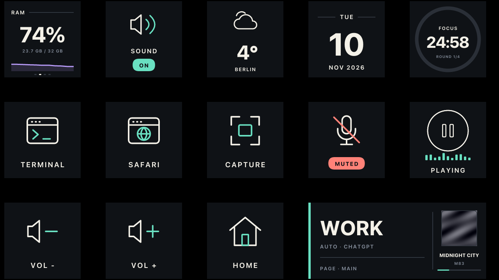
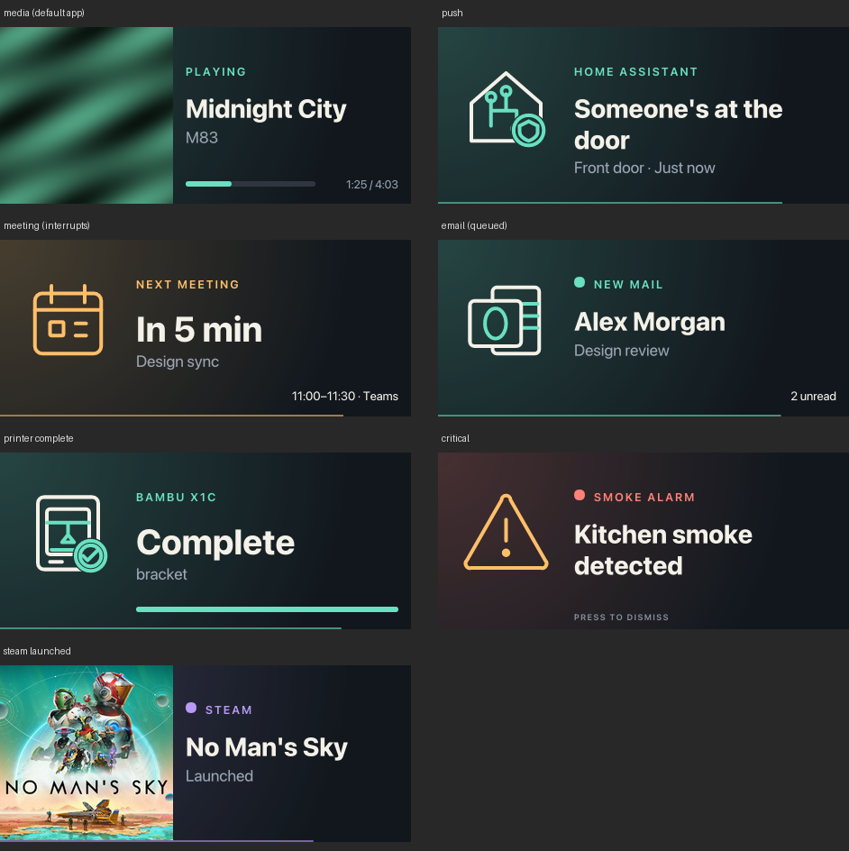
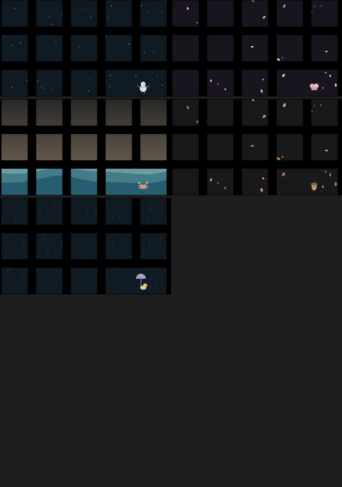
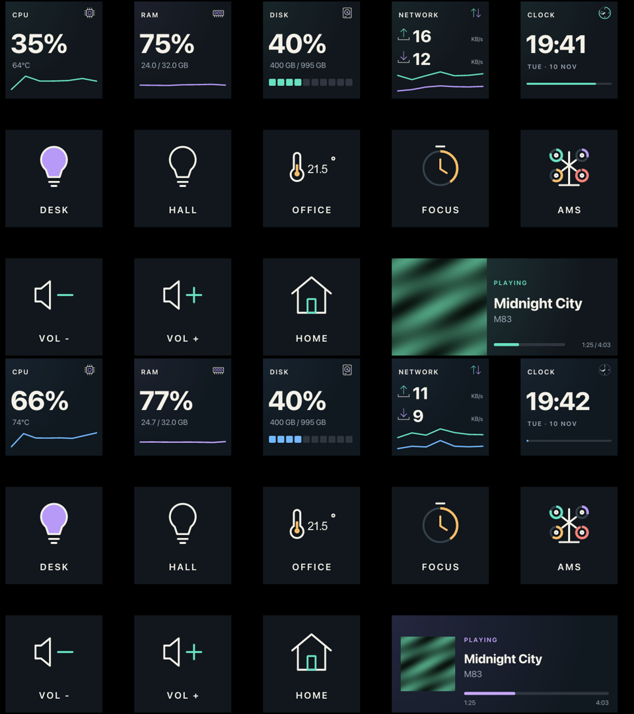
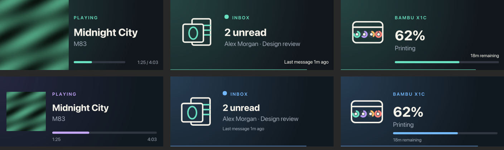

# Night Signal design

The design specs the app follows. The rules that matter most:

- **Palette:**
  - background `#11171D`
  - ivory `#F4F1E8` (text, strokes)
  - mint `#69E0C1` (on, live, active)
  - coral `#FF8278` (muted, off, error)
  - amber `#FFBF69` (attention, away)
  - lavender `#B79AF7` (info, graphs)
  - secondary text `#9BA5B2`, muted `#87909E`, lines `#30363F`
- **Type:** uppercase, letter-spaced labels, and big bold figures for values.
- **Shapes:** status pills, and a soft directional glow instead of side stripes.
- **Wide key:** cover 42 %, symbol 27 %, inset 3 % (Compact). Airy uses a 24 % square cover,
  18 px padding and a metadata line.
- Colours come from the theme (`settings.theme`), never hard-coded in a widget.

| Spec | Contents |
|---|---|
| [icon-set.md](icon-set.md) | the icon set: naming, groups, stroke rules |
| [stateful-icons.md](stateful-icons.md) | icons with live state (`data-part`, `setIconState`) |
| [widgets-state-guide.md](widgets-state-guide.md) | which state each widget shows when |
| [widgets-theming.md](widgets-theming.md) | the theme API: palette and per-widget overrides |
| [screensaver.md](screensaver.md) | seasonal screensaver scenes and timing |

Renders:

| | |
|---|---|
|  |  |
|  |  |
|  | |
